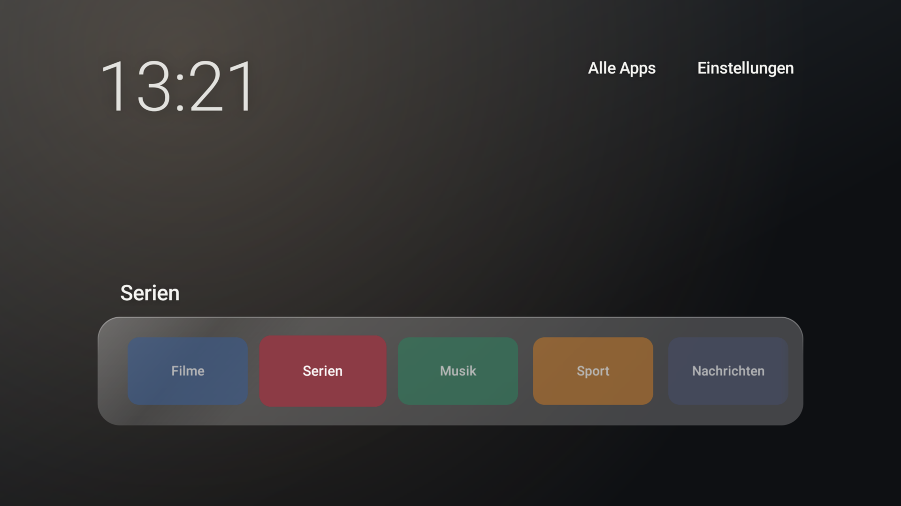
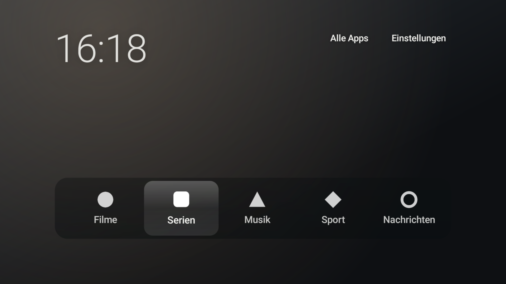
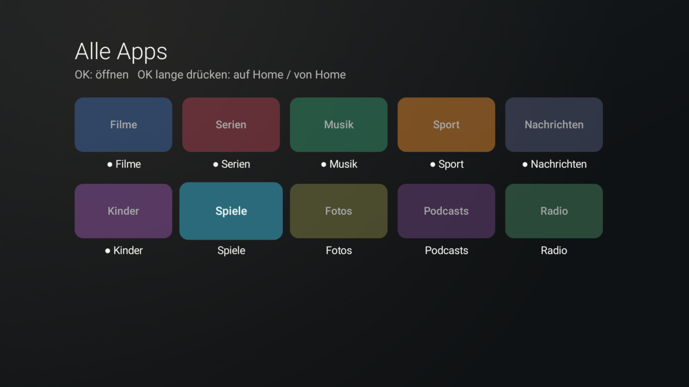
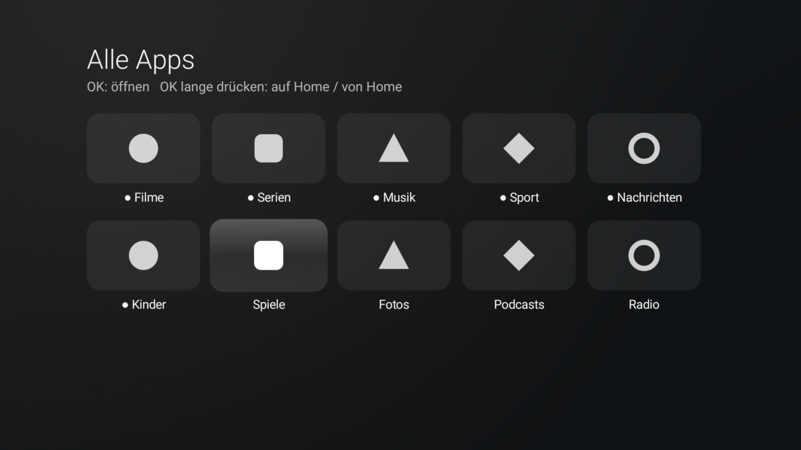

# Quiet Home

A small, ad-free home screen for the NVIDIA SHIELD TV (2019, Android 11). It replaces the stock
launcher with a clock, a glass dock of apps and nothing else: no recommendations, no channels, no
network access.

The look follows [CleanFrame](https://github.com/nthnclrk/CleanFrame) by Nathan Clark, a home
screen for Samsung's The Frame TV. CleanFrame is a Tizen web app; this is a separate Android
implementation of its Dock layout, not a port of its code.

Two styles, switched under *Einstellungen → App-Icons*:

| Classic: the apps' own banners | Quiet: white marks and names, as in CleanFrame |
| --- | --- |
|  |  |
|  |  |

*Screenshots from the demo build (see [Build](#build)) with placeholder tiles and the built-in
gradient. On a device, the dock shows the installed apps on your own wallpaper.*

## Features

- **Home:** clock top left, *All apps* and *Settings* top right, a glass dock with the apps on Home.
  A long press on OK picks a dock app up, ◀ ▶ moves it, OK places it.
- **All apps:** every launchable app in a five-column grid. OK opens an app; a long press on OK
  adds it to Home or removes it. (The SHIELD keeps the remote's ☰ key for its own menu, so it
  cannot be used here.)
- **Two styles:** *Classic* shows each app's banner. *Quiet* shows a white mark with the app name,
  like CleanFrame; see [App marks](#app-marks-quiet-style).
- **Quiet dock:** *Einstellungen → Menüleiste → Quiet* gives the dock CleanFrame's "Soft"
  material, lighter and less blurred here: the photo shows through, darkened per photo so that
  white names stay readable. *Classic* keeps the light glass. The dock style is independent of the
  app style.
- **Settings:** app style, dock style, wallpaper (your own photos or a built-in gradient), optional rotation
  on each return to Home, and the app the remote's Netflix key starts.
- **Netflix key remap:** an accessibility service catches the SHIELD remote's Netflix key
  (`BUTTON_12` in `Vendor_0955_Product_7217.kl`) and starts the chosen app instead.
- **Readable text on any photo:** Quiet Home measures the blurred photo behind the clock, the
  controls and the app name, and picks light or dark text by WCAG contrast. Where neither reaches
  4.5:1, the text gets a tight halo in the opposite tone.
- **Glass without live blur:** when a wallpaper loads, Quiet Home blurs a 160×90 copy of it once;
  that copy backs the glass surfaces, so nothing is blurred while drawing.

## Performance

Measured on a SHIELD TV Pro 2019 (Android 11, build 7825230_4387.0822) with `dumpsys meminfo`:

| | Total PSS | Swap PSS | Cold start |
| --- | --- | --- | --- |
| Quiet Home 0.1.0 | 112–118 MB | 0.3 MB | 890 ms |
| Projectivy Launcher 4.72 | 173–210 MB | 55–59 MB | not measured |

About 60 MB of native heap is the graphics stack's baseline on this device: an empty test screen
used 17 MB, any screen with text and shapes about 60 MB, and Projectivy has the same allocation
(about 70 MB), most of it swapped out. The app uses only framework views (no Compose, no AndroidX)
to keep the rest small.

## Requirements

- An Android TV device with Android 11 (API 30) or newer. Only the SHIELD TV Pro 2019 has been
  tested. The Netflix key remap expects the SHIELD remote that came with the 2019 models.
- The interface is in German.
- ADB on a computer, and network debugging enabled on the device (*Device Preferences →
  Developer options*; the developer options appear after pressing OK seven times on *Device
  Preferences → About → Build*).
- To build it yourself: JDK 17 or 21 and the Android SDK (platform 35, build-tools 35.0.0).
  Gradle comes with the wrapper.

## Download

Signed APKs are attached to the [releases](https://github.com/NicolasPogorzelski/quiet-home/releases).
Each release lists the SHA-256 of its APK; compare it before installing:

```bash
sha256sum quiet-home-<version>.apk
```

## Build

```bash
echo "sdk.dir=$HOME/Android/Sdk" > local.properties
./gradlew lintRelease assembleRelease
```

The APK is written to `app/build/outputs/apk/release/app-release.apk`. Without a release key (see
[Releasing](#releasing)) it is signed with your local debug key, which works for your own device
but cannot update a downloaded release; uninstall that first.

`./gradlew assembleRelease -PquietHome.demo=true` builds a separate demo app
(`io.github.nicolaspogorzelski.quiethome.demo`) with placeholder tiles instead of the installed
apps, for screenshots without third-party logos. Installing it next to Quiet Home resets the
chosen home screen; set it again after uninstalling the demo.

## Install and make it the home screen

```bash
adb connect <device-ip>:5555
adb install -r quiet-home-<version>.apk   # or app/build/outputs/apk/release/app-release.apk

# Make it the home screen
adb shell cmd package set-home-activity io.github.nicolaspogorzelski.quiethome/.HomeActivity

# Enable the Netflix key remap (this replaces any other enabled accessibility services)
adb shell settings put secure enabled_accessibility_services \
  io.github.nicolaspogorzelski.quiethome/io.github.nicolaspogorzelski.quiethome.KeyRemapService
adb shell settings put secure accessibility_enabled 1
```

Android drops the chosen home app whenever another app that can be a home screen is installed.
The next press on Home then asks once; choose Quiet Home and *Always*.

## Wallpapers

Quiet Home ships without photos. Until you add some, it shows a built-in dark gradient. It reads
wallpapers from its own folder on the device:

```
/sdcard/Android/data/io.github.nicolaspogorzelski.quiethome/files/wallpapers/
```

The folder exists once Quiet Home has been started. Supported formats are JPEG, PNG and WebP.
Any size works; photos are centre-cropped to 16:9 and scaled to 1920×1080, so 16:9 photos of at
least 1920×1080 look best. The file name is the name in Settings, with underscores shown as
spaces (`Blue_peaks.jpg` appears as "Blue peaks").

### With the script

[`tools/install-wallpapers.sh`](tools/install-wallpapers.sh) needs `adb` and `curl`. It takes local
files, Unsplash photo IDs, or both:

```bash
# Local photos
tools/install-wallpapers.sh ~/Pictures/beach.jpg ~/Pictures/Night_sky.png

# Photos from Unsplash: the ID is the last part of the photo's URL,
# unsplash.com/photos/<ID>; "=Name" sets the file name. Downloads are 2560 px wide.
tools/install-wallpapers.sh rQqWOHZ96OM=Blue_peaks M6XC789HLe8=Mountain_valley

# Keep the downloaded files in a folder instead of a temporary directory
tools/install-wallpapers.sh --keep ~/Pictures/quiet-home rQqWOHZ96OM=Blue_peaks

# Show and remove installed wallpapers
tools/install-wallpapers.sh --list
tools/install-wallpapers.sh --remove Blue_peaks.jpg
```

If more than one device is connected, select one with `-s <device-ip>:5555`, the address shown by
`adb devices`. Then choose the photo in Quiet Home under *Einstellungen → Hintergrund* (Settings →
Wallpaper; the interface is German) with ◀ ▶.

### By hand

```bash
adb shell mkdir -p /sdcard/Android/data/io.github.nicolaspogorzelski.quiethome/files/wallpapers
adb push Blue_peaks.jpg /sdcard/Android/data/io.github.nicolaspogorzelski.quiethome/files/wallpapers/
```

A photo replaced under the same file name shows after Quiet Home restarts. Uninstalling Quiet
Home deletes the folder with the photos in it.

### Suggested photos

The design reference, CleanFrame, uses Unsplash photos. These five look good with the dock. All
five pages showed the [Unsplash License](https://unsplash.com/license) when checked on 2026-10-24;
check the page yourself before you use a photo, since the terms are between you, Unsplash and the
photographer.

| ID | Photo | Photographer |
| --- | --- | --- |
| `rr2EF3J5F2Y` | [Misty evergreen forest](https://unsplash.com/photos/rr2EF3J5F2Y) | Dejan Zakic |
| `M6XC789HLe8` | [Granite cliffs and waterfall in Yosemite](https://unsplash.com/photos/M6XC789HLe8) | Aniket Deole |
| `rQqWOHZ96OM` | [Snow capped mountains](https://unsplash.com/photos/rQqWOHZ96OM) | John Rodenn Castillo |
| `pbp_Ww2cewA` | [Golden Gate Bridge](https://unsplash.com/photos/pbp_Ww2cewA) | Justin Wolff |
| `tmtkhWbgMu8` | [Ocean with rocks, Big Sur](https://unsplash.com/photos/tmtkhWbgMu8) | Karthik Sreenivas |

```bash
tools/install-wallpapers.sh rr2EF3J5F2Y=Forest_mist M6XC789HLe8=Mountain_valley \
  rQqWOHZ96OM=Blue_peaks pbp_Ww2cewA=Bridge_at_dusk tmtkhWbgMu8=Golden_hour
```

## App marks (Quiet style)

Quiet Home ships without logos. For each app it uses the first of these that exists:

1. a mark you installed (below),
2. the app's own monochrome icon, which some apps include for Android 13 themed icons
   (for example Jellyfin, Moonlight, Tailscale),
3. a mark derived from the app icon: the background is removed and the rest turned white,
4. the app icon itself, in colour.

Marks live in Quiet Home's folder on the device, one file per app, named after the package:

```
/sdcard/Android/data/io.github.nicolaspogorzelski.quiethome/files/icons/<package>.svg
/sdcard/Android/data/io.github.nicolaspogorzelski.quiethome/files/icons/<package>.png
```

An SVG is drawn white from its paths (single-colour marks such as Simple Icons). A PNG keeps its
shape and is turned white, so use a mark on a transparent background. If both exist, the SVG wins.
Quiet Home picks up changes the next time Home is shown.

### With the script

[`tools/install-icons.sh`](tools/install-icons.sh) needs `adb` and `curl`. Without arguments it
downloads marks from [Simple Icons](https://simpleicons.org) (version 16.34.0) for every app in
[`tools/icons.tsv`](tools/icons.tsv) that is installed on the device:

```bash
tools/install-icons.sh

# A Simple Icons mark of your choice, or your own file, for one app
tools/install-icons.sh com.netflix.ninja=netflix
tools/install-icons.sh de.swr.avp.ard.tv=~/Pictures/ard-mark.svg

# Show and remove installed marks
tools/install-icons.sh --list
tools/install-icons.sh --remove com.netflix.ninja
```

`adb shell pm list packages` lists the package names. Add lines to `tools/icons.tsv` for further
apps. Some brands are not in Simple Icons (Prime Video, ARD, Joyn, Moonlight); those apps fall
back to steps 2 to 4.

The Simple Icons drawings are CC0, but the brands remain trademarks of their owners and single
icons can carry other licences; see the [Simple Icons disclaimer](https://github.com/simple-icons/simple-icons/blob/develop/DISCLAIMER.md).
The script downloads them for your own device; this repository contains none.

### By hand

```bash
adb shell mkdir -p /sdcard/Android/data/io.github.nicolaspogorzelski.quiethome/files/icons
adb push netflix.svg /sdcard/Android/data/io.github.nicolaspogorzelski.quiethome/files/icons/com.netflix.ninja.svg
```

## Undo

```bash
# Back to another launcher, for example Projectivy
adb shell cmd package set-home-activity com.spocky.projengmenu/.ui.home.MainActivity
# Turn the key remap off (or set the previous value of enabled_accessibility_services)
adb shell settings delete secure enabled_accessibility_services
adb uninstall io.github.nicolaspogorzelski.quiethome
```

## Releasing

Release APKs are signed locally with a key that never enters the repository or GitHub. Gradle
reads it from `~/.gradle/gradle.properties`:

```properties
quietHome.storeFile=/home/<user>/.config/quiet-home/release.jks
quietHome.storePassword=<password>
quietHome.keyAlias=quiet-home
quietHome.keyPassword=<password>
```

1. Raise `versionCode` and `versionName` in `app/build.gradle.kts` and commit.
2. Build and check the signature:

   ```bash
   ./gradlew lintRelease assembleRelease
   apksigner verify --print-certs app/build/outputs/apk/release/app-release.apk
   cp app/build/outputs/apk/release/app-release.apk quiet-home-<version>.apk
   sha256sum quiet-home-<version>.apk
   ```

3. Publish with the checksum in the notes:

   ```bash
   gh release create v<version> quiet-home-<version>.apk --title "Quiet Home <version>" \
     --notes "SHA-256: <checksum>"
   ```

Keep a backup of the key file and its passwords outside this computer. Without them, no update
can be installed over an existing Quiet Home; it has to be uninstalled first.

## Ideas

Possible later improvements, not planned yet:

- **Heavier clock on busy photos.** The clock uses a light weight. On mid-toned, detailed photos
  (for example the granite cliffs in *Mountain valley*) its thin strokes stay hard to read even
  with the halo. A regular weight where the halo is active, or as a setting, would help, at the
  cost of some of the light look.
- **Focus the last app on return.** Coming back from an app with Home puts the focus on the first
  dock app and scrolls the dock to the start. Focusing the last launched app instead (as
  CleanFrame does) would save key presses; Home pressed while already on Home would still jump
  to the start.
- **Hide apps in All apps.** System tools (Android settings, Files, Gallery, Input Viewer, Play
  Store, other launchers) fill the grid. A long press on OK could open a small menu (*Add to /
  remove from Home*, *Hide*, *Cancel*; in the dock *Move*, *Remove from Home*, *Cancel*), with
  hidden apps in a dimmed section at the end of All apps.

## How this repository is built

The launcher was specified, tested on the device and reviewed by Nicolas Pogorzelski. The code,
the measurements and this README were written with an LLM-based coding assistant (Claude Code)
working under his direction; every change reaches the device and the repository only after his
approval.

## Credits

- Design: [CleanFrame](https://github.com/nthnclrk/CleanFrame), © 2026 Nathan Clark, MIT License.
  Colours, timings and the dock geometry follow its `style.css`.
- No photos, logos or fonts are bundled. Wallpapers and app marks are added by the user (see
  [Wallpapers](#wallpapers) and [App marks](#app-marks-quiet-style)); app banners and icons are
  read from the installed apps at runtime.

NVIDIA and SHIELD are trademarks of NVIDIA Corporation. This project is not affiliated with or
endorsed by NVIDIA.

## License

[MIT](LICENSE). Third-party material and its terms are listed in
[THIRD_PARTY_NOTICES.md](THIRD_PARTY_NOTICES.md).
